# CineBook — Online Movie Ticket Booking & Theatre Management System

**DBMS Mini-Project · Experiential Learning Level 3 · PES University, Dept. of CSE · Aug–Dec 2026**

**Team:** Member 1 – Nikita Mankani (SRN: PES1UG24CS300) · Member 2 – Niyatee Singh (SRN: PES1UG24CS305)  
**Stack:** MySQL 8.0 · Redis 7 · Next.js 14 (React 18) · Node.js  
**Repository:** https://github.com/[username]/movie-ticket-booking-dbms

---

## 1. Problem statement & scope

Theatre chains need one system where **customers** can find shows, choose exact seats, pay and cancel,
and **theatre admins** can manage movies, schedule shows without clashes and monitor revenue.

Our system covers:

- 3 theatres in Bengaluru, each with **only Screen 1 and Screen 2**, 50 seats per screen (rows A–E, row E premium).
- Movies with multiple genres, show scheduling with clash detection, seat-level booking with no double-selling,
  1:1 payment per booking, cancellation with automatic refund.
- A referral programme (customers refer customers) — a recursive relationship.
- **Redis** (NoSQL) for two jobs: live 5-minute **seat holds** while a customer is choosing seats, and free-text reviews/ratings.
- Three roles — **ADMIN** (platform), **THEATRE_ADMIN** (one theatre) and **CUSTOMER** — enforced in the web app *and* inside MySQL.

**Simplification (faculty feedback).** The first version had 19 entities (offers, pricing rules, waitlists,
seat holds, notifications, refunds, languages, genres, theatre-admins, …). As advised, we reduced it to
**8 entities** while keeping one clear example of every ER construct. Removed concepts were absorbed
as attributes (Language, Role, Payment.Status for refunds) or handled by constraints (UNIQUE seat-per-show
as the final guard against double booking). Seat holds and reviews moved to Redis, where short-lived and schema-less data belongs.

## 2. Technology justification

| Choice | Why |
|---|---|
| **MySQL 8.0** (relational) | Bookings and payments are transactional money data → need ACID transactions, foreign keys, CHECK constraints (enforced since 8.0.16), triggers, stored routines, recursive CTEs & window functions (8.0+) and built-in **roles** for RBAC. |
| **Redis 7** (NoSQL key-value) | Reviews are schema-less free text, read-heavy and not needed for any transaction. Hashes map naturally to a review document; a **sorted set** gives an O(log n) "top-rated" leaderboard; Lua scripts give atomic recomputation of averages. Keeps the relational schema small. |
| **Next.js 14** | One codebase for React UI and server-side API routes; API routes run on Node and talk directly to MySQL (`mysql2`) and Redis (`redis`). |
| **bcrypt + JWT (httpOnly cookie)** | Passwords never stored in plain text; stateless sessions; middleware blocks pages by role. |

## 3. Database design

### 3.1 ER diagram

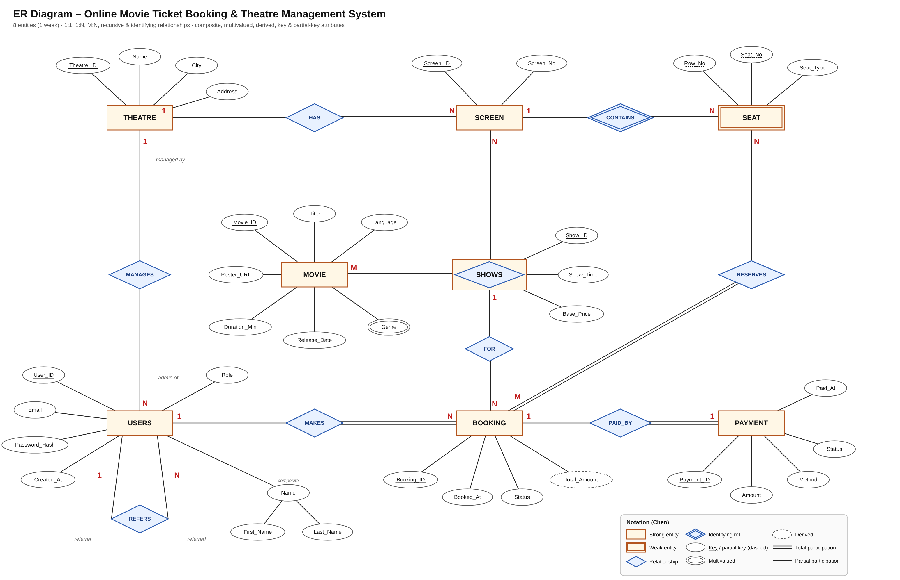

| ER construct | Example in our design |
|---|---|
| Strong entities | THEATRE, SCREEN, MOVIE, USERS, BOOKING, PAYMENT, SHOWS |
| Weak entity + identifying relationship | **SEAT** identified by SCREEN through **CONTAINS** (partial key Row_No + Seat_No) |
| Associative entity (M:N with attributes) | **SHOWS** between MOVIE and SCREEN (Show_Time, Base_Price) |
| 1:1 | BOOKING — PAID_BY — PAYMENT |
| 1:N | THEATRE—HAS—SCREEN, USERS—MAKES—BOOKING, SHOWS—FOR—BOOKING, THEATRE—MANAGES—USERS(theatre admin) |
| M:N | MOVIE–SCREEN (via SHOWS), BOOKING—RESERVES—SEAT |
| Recursive (unary) | USERS—REFERS—USERS (referrer / referred) |
| Composite attribute | Name → First_Name, Last_Name |
| Multivalued attribute | Genre of MOVIE |
| Derived attribute | Total_Amount of BOOKING (sum of seat prices) |
| Key / partial key | Underlined / dashed underline |
| Total participation | SCREEN in HAS, SEAT in CONTAINS, BOOKING in MAKES/FOR, PAYMENT in PAID_BY |

### 3.2 ER → relational mapping

| Step | Rule applied | Result |
|---|---|---|
| Strong entities | one table each, simple attributes as columns | THEATRE, SCREEN, MOVIE, USERS, SHOWS, BOOKING, PAYMENT |
| Composite attr. | keep only the simple components | USERS(First_Name, Last_Name) |
| Weak entity | owner PK + partial key = PK; FK ON DELETE CASCADE | SEAT(**Screen_ID, Row_No, Seat_No**) |
| 1:N | FK on the N side | SCREEN.Theatre_ID, BOOKING.User_ID, BOOKING.Show_ID, USERS.Theatre_ID |
| 1:1 (total on PAYMENT) | FK + UNIQUE on the total side | PAYMENT.Booking_ID UNIQUE |
| M:N with attributes | associative table with own PK | SHOWS(Show_ID, Movie_ID, Screen_ID, …) |
| M:N | relationship table, PK = both keys | BOOKING_SEAT(Booking_ID, Screen_ID, Row_No, Seat_No) |
| Multivalued attr. | separate table, PK = owner key + value | MOVIE_GENRE(**Movie_ID, Genre**) |
| Recursive 1:N | FK to same table | USERS.Referred_By → USERS.User_ID |
| Derived attr. | stored, maintained by trigger | BOOKING.Total_Amount |

### 3.3 Relational schema

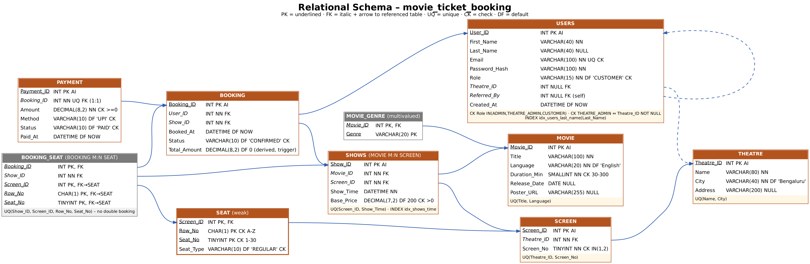

```
THEATRE      (Theatre_ID PK, Name, City, Address)
USERS        (User_ID PK, First_Name, Last_Name, Email UQ, Password_Hash, Role,
              Theatre_ID FK→THEATRE, Referred_By FK→USERS, Created_At)
SCREEN       (Screen_ID PK, Theatre_ID FK→THEATRE, Screen_No)          UQ(Theatre_ID, Screen_No)
SEAT         (Screen_ID FK→SCREEN, Row_No, Seat_No, Seat_Type)          PK(Screen_ID, Row_No, Seat_No)
MOVIE        (Movie_ID PK, Title, Language, Duration_Min, Release_Date, Poster_URL)
                                                                         UQ(Title, Language)
MOVIE_GENRE  (Movie_ID FK→MOVIE, Genre)                                  PK(Movie_ID, Genre)
SHOWS        (Show_ID PK, Movie_ID FK→MOVIE, Screen_ID FK→SCREEN, Show_Time, Base_Price)
                                                                         UQ(Screen_ID, Show_Time)
BOOKING      (Booking_ID PK, User_ID FK→USERS, Show_ID FK→SHOWS, Booked_At, Status, Total_Amount)
BOOKING_SEAT (Booking_ID FK→BOOKING, Show_ID FK→SHOWS, (Screen_ID, Row_No, Seat_No) FK→SEAT)
              PK(Booking_ID, Screen_ID, Row_No, Seat_No)   UQ(Show_ID, Screen_ID, Row_No, Seat_No)
PAYMENT      (Payment_ID PK, Booking_ID FK→BOOKING UQ, Amount, Method, Status, Paid_At)
```

### 3.4 Constraint summary (all in `sql/01_schema.sql`)

| Type | Examples |
|---|---|
| PRIMARY KEY | single (Movie_ID…), composite (SEAT, MOVIE_GENRE, BOOKING_SEAT) |
| FOREIGN KEY | 12 FKs; 5 × `ON DELETE CASCADE` (THEATRE→SCREEN, SCREEN→SEAT, MOVIE→MOVIE_GENRE, BOOKING→BOOKING_SEAT, BOOKING→PAYMENT), `ON DELETE SET NULL` (Referred_By), default RESTRICT elsewhere |
| UNIQUE | Email; (Theatre_ID, Screen_No); (Screen_ID, Show_Time); (Show_ID, seat) = no double booking; PAYMENT.Booking_ID = 1:1 |
| NOT NULL / NULL | NOT NULL on all mandatory data; NULL allowed for Last_Name, Release_Date (upcoming film), Theatre_ID (customers), Referred_By |
| DEFAULT | City 'Bengaluru', Role 'CUSTOMER', Seat_Type 'REGULAR', Language 'English', Base_Price 200, Status 'CONFIRMED'/'PAID', Method 'UPI', timestamps `CURRENT_TIMESTAMP` |
| CHECK | Screen_No IN (1,2); Role IN ('ADMIN','THEATRE_ADMIN','CUSTOMER'); THEATRE_ADMIN ⇔ Theatre_ID NOT NULL; email pattern; Duration 30–300; Seat_No 1–30; Row A–Z; price > 0; amount ≥ 0; enums for Status/Method/Seat_Type |

## 4. SQL implementation

| File | Contents |
|---|---|
| `01_schema.sql` | CREATE DATABASE + 10 tables with every constraint above |
| `02_programs.sql` | 2 functions, 4 triggers, 3 procedures, 1 view |
| `03_seed.sql` | sample data — 300 seats generated with CROSS JOIN, bookings created through the procedure |
| `04_bulk_and_index.sql` | 4,200 customers via recursive CTE, EXPLAIN before/after index |
| `05_queries.sql` | DML + 11 complex queries + program calls |
| `06_roles.sql` | roles, users, grants, two-terminal demo |
| `08_today_shows.sql`, `09_posters.sql`, `10_real_posters.sql` | extra movies + shows for today, poster images |
| `11_upgrade.sql` | idempotent upgrade: Address, 3 roles, cancel locking, trigger 4, shows for the next 5 days (recursive-CTE generator, no clashes) |
| `12_future_shows.sql` | shows on every screen from today to 19 Nov (4 slots/day, clash-checked) + ~620 upcoming bookings made through `sp_book_seats` (mix of empty, available, fast-filling and sold-out shows; every 3rd show left empty for demos) |
| `scripts/concurrency_test.js` | concurrency & throughput test (section 13) |

**Row counts after setup**

| Table | Rows | Why this many |
|---|---|---|
| THEATRE | 3 | three multiplexes |
| SCREEN | 6 | only Screen 1 & 2 per theatre |
| SEAT | 300 | 5 rows × 10 seats × 6 screens |
| MOVIE / MOVIE_GENRE | 14 / 29 | incl. 1 upcoming movie without shows (for the NOT IN query) |
| SHOWS | ≈180 | seed + today's shows + generated shows up to 19 Nov (4 slots/screen/day), clash-free |
| USERS | **4,213** | 1 platform admin + 3 theatre admins + 9 named customers + **4,200 bulk** (>4k requirement) |
| BOOKING / BOOKING_SEAT / PAYMENT | ≈636 / 1,554 / 636 | seed bookings + upcoming bookings from `12`; cancelled ones → refunds (exact counts depend on the day `12` is run) |

## 5. DML operations

- **INSERT** – seed data; new movie + genres (`05` A1); new user (web register); bookings via `sp_book_seats`.
- **UPDATE** – 10 % price rise for evening shows (A2); profile update (A3); cancellation (`sp_cancel_booking`); admin movie edit (web).
- **DELETE** – genre tag (A4); movie with cascade to genres (A5); show / movie delete from admin UI (FK blocks deleting a movie that has shows).
- **Constraint violations** demonstrated (A6): CHECK (Screen 3), UNIQUE email, 1:1 payment, FK, double booking.

## 6. Complex queries (`sql/05_queries.sql`)

| # | Type | Question answered |
|---|---|---|
| Q1 | 4-table JOIN + function | Full show listing with theatre, screen, seats left |
| Q2 | JOIN + GROUP BY + **HAVING** (nested subquery in HAVING) | Theatres earning more than the average theatre |
| Q3 | GROUP BY + HAVING + GROUP_CONCAT | Genres that appear in >1 movie |
| Q4 | **Nested** (NOT IN) | Movies never scheduled |
| Q5 | Nested, 2 levels | Customers who booked the most expensive show |
| Q6 | **Correlated** | Customers spending above the average customer |
| Q7 | Correlated EXISTS | Shows with at least one premium seat sold |
| Q8 | **Recursive CTE** | Referral chain from Nikita |
| Q9 | CTE + window RANK() | Best-selling movie per theatre |
| Q10 | LEFT JOIN + aggregation | Occupancy % of every show (zero-sale shows included) |
| Q11 | Conditional aggregation | Payments collected vs refunded per method |

**Sample outputs** (full log: `docs/sample_outputs/05_queries_output.txt`; Q2 after `12_future_shows.sql`, the others from the base seed)

Q2 — HAVING
```
| Theatre                        | Bookings | Revenue | Avg_Booking_Value |
| Regal Screens Jayanagar        |      210 | 144065.00 |            686.02 |
| Starlight Multiplex Whitefield |      217 | 144055.00 |            663.85 |   (Galaxy 138455 < average → filtered out)
```
Q6 — correlated subquery
```
| User_ID | First_Name | Last_Name | Total_Spent |
|       5 | Rahul      | Verma     |     1845.00 |
|       7 | Arjun      | Nair      |     1590.00 |
|       4 | Nikita     | Mankani   |     1460.00 |
|       8 | Kavya      | Reddy     |     1115.00 |
```
Q8 — recursive CTE
```
| User_ID | First_Name | Level | Path                                       |
|       4 | Nikita     |     0 | Nikita                                     |
|       5 | Rahul      |     1 | Nikita -> Rahul                            |
|       9 | Priya      |     1 | Nikita -> Priya                            |
|       6 | Sneha      |     2 | Nikita -> Rahul -> Sneha                   |
|       7 | Arjun      |     3 | Nikita -> Rahul -> Sneha -> Arjun          |
|       8 | Kavya      |     4 | Nikita -> Rahul -> Sneha -> Arjun -> Kavya |
```
Q4 — nested: `6 | Lost in Bengaluru | Kannada` (upcoming film, no show yet).

## 7. Advanced SQL — procedures, functions, triggers, CTE (`sql/02_programs.sql`)

| Object | Kind | What it does |
|---|---|---|
| `fn_seat_price(show, screen, row, seat)` | function | base price, ×1.5 for PREMIUM |
| `fn_seats_left(show)` | function | capacity − sold; used by view and UI |
| `trg_bs_before_insert` | BEFORE INSERT trigger on BOOKING_SEAT | rejects seats from another screen, mismatched show, or a cancelled booking (`SIGNAL 45000`) |
| `trg_bs_after_insert` | AFTER INSERT trigger on BOOKING_SEAT | maintains derived `BOOKING.Total_Amount` |
| `trg_booking_after_cancel` | AFTER UPDATE trigger on BOOKING | on CANCELLED → PAYMENT REFUNDED + seats released |
| `trg_shows_before_delete` | BEFORE DELETE trigger on SHOWS | a show that has already started cannot be deleted (keeps revenue history) |
| `sp_book_seats(user, show, 'A1,E5', method, OUT id)` | procedure | parses seat list, one **transaction** (booking + seats + payment), EXIT HANDLER → ROLLBACK + RESIGNAL |
| `sp_cancel_booking(booking, user)` | procedure | **transaction + `SELECT … FOR UPDATE`** row lock; customer only own booking and only before the show, ADMIN any; then cancels (fires trigger) → no double refund |
| `sp_add_show(movie, screen, time, price, OUT id)` | procedure | rejects overlapping shows (duration + 20 min cleaning) |
| `v_show_details` | view | one row per show for the UI |
| CTEs | recursive (Q8, bulk generator in `04`), non-recursive + window (Q9, admin dashboard) |

Trigger demo (from the log):
```
CALL sp_book_seats(9, @show, 'A1,E1', 'UPI', @b);   -> Total_Amount = 500.00 (200 regular + 300 premium)
CALL sp_cancel_booking(@b, 9);                  -> Status CANCELLED, Payment REFUNDED, Seats_Held 0
CALL sp_book_seats(5, 1, 'C5', 'UPI', @x);      -> ERROR: Duplicate entry ... uq_seat_per_show
CALL sp_add_show(1, 2, <overlapping time>, ...) -> ERROR 1644: Screen is busy at that time
```

## 8. Indexing & bulk data (`sql/04_bulk_and_index.sql`)

- **Table:** USERS (least-used table in transactions — 4,200 registered-but-inactive customers don't distort revenue/booking figures).
- **Generation:** `WITH RECURSIVE seq` 1…4200 (`cte_max_recursion_depth` raised to 5000) + `ELT()` to vary names.
- **Index:** `CREATE INDEX idx_users_last_name ON USERS(Last_Name)` (non-PK). Second index: `idx_shows_time`.

```
Before:  type=ALL  key=NULL                 rows=4213   (full table scan)
After:   type=ref  key=idx_users_last_name  rows=280    (index lookup, ~15x fewer rows read)
```
The admin "Customers" tab runs this search live and displays the EXPLAIN plan.

## 9. NoSQL — Redis (`redis/`, `web/lib/reviews.js`)

**Database creation / data model** (namespace `cine:` in DB 0):

| Key | Type | Content |
|---|---|---|
| `cine:review:<movieId>:<userId>` | HASH | movie_id, user_id, user_name, rating, comment, created_at, updated_at |
| `cine:movie:<movieId>:reviews` | SET | keys of the movie's reviews |
| `cine:user:<userId>:reviews` | SET | keys of the user's reviews |
| `cine:top_rated` | SORTED SET | member = movieId, score = average rating |

The key `<movieId>:<userId>` enforces "one review per user per movie" (a NoSQL equivalent of a composite key).
Movie_ID / User_ID refer to MySQL primary keys (polyglot persistence).

**RUD operations**

| Op | redis-cli | Web (API) |
|---|---|---|
| Create | `HSET cine:review:1:4 …` + `SADD` + Lua recalc | POST `/api/reviews` (customer) |
| Read | `HGETALL`, `SMEMBERS`, `HMGET`, `ZREVRANGE … WITHSCORES`, `ZSCORE` | GET `/api/reviews?movieId=`, admin dashboard "Top rated" |
| Update | `HSET cine:review:4:5 rating 5 comment …` → avg 3.5 → 4.5 | POST again on same movie = update |
| Delete | `DEL` + `SREM` ×2 + Lua recalc | DELETE `/api/reviews` (own) · DELETE `/api/admin/reviews` (moderation) |

Atomicity: `MULTI/EXEC` for multi-key writes; a **Lua script** recalculates the average inside Redis.
Full output: `docs/sample_outputs/redis_rud_output.txt`.

## 10. Web application & API integration (`web/`)

**Architecture:** Browser (React pages) → Next.js API routes (Node) → `mysql2` pool **per role** / `redis` client.

| Area | Endpoints |
|---|---|
| Auth | POST `/api/auth/login`, `/api/auth/register`, `/api/auth/logout`, GET `/api/auth/me` |
| Customer | GET `/api/shows`, GET `/api/shows/:id/seats`, GET/POST `/api/bookings`, POST `/api/bookings/:id/cancel`, GET `/api/movies`, GET/POST/DELETE `/api/reviews` |
| Admin | POST/PUT/DELETE `/api/admin/movies[/:id]`, GET/POST/DELETE `/api/admin/shows[/:id]`, GET `/api/admin/screens`, `/api/admin/bookings`, `/api/admin/reports`, `/api/admin/users?lastName=`, `/api/admin/users/:id/referrals`, GET/DELETE `/api/admin/reviews` |

**Customer UI:** **Movies** (filters for language / genre / cinema, poster grid with ratings) → **movie page**
(date strip, showtimes per cinema with Available / Fast filling / Sold out, verified reviews, "You might also like")
→ **seat map** (premium / sold / selected / *on hold by someone else*, 5-minute hold countdown) → pay;
**Cinemas** (search by cinema or area, price and show-time filters); **My Bookings** (Upcoming → cancel & refund,
Watched → rate & review, Cancelled); **Profile** (spent, tickets, refunds, favourite genre, referrals, own reviews).

**Platform admin:** Dashboard (all theatres), Movies (CRUD + posters, genres in one transaction), Shows (filters,
schedule on any screen with clash detection), Bookings (cancel & refund), Customers (indexed last-name search +
referral network), Reviews (moderation).
**Theatre admin:** the same Dashboard / Shows / Bookings, scoped to their own theatre only. Past shows are shown as
COMPLETED (no delete); shows with bookings show the booking count instead of Delete.

New APIs: `/api/theatres`, `/api/movies/:id`, `/api/me/profile`, `/api/shows/:id/hold` (Redis seat holds).

| | |
|---|---|
| 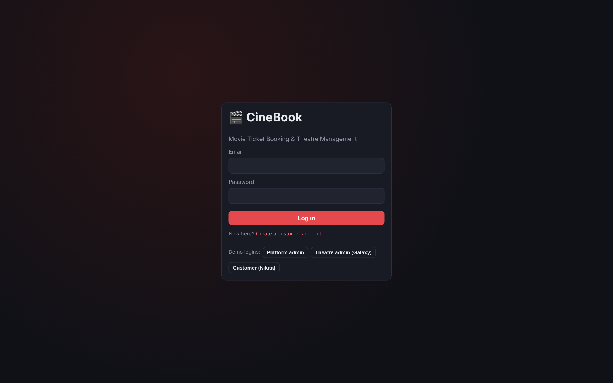 Login | 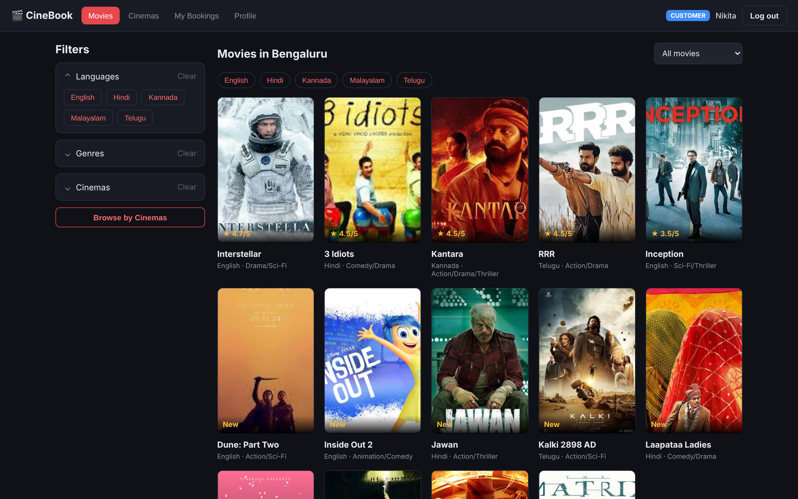 Movies + filters |
| 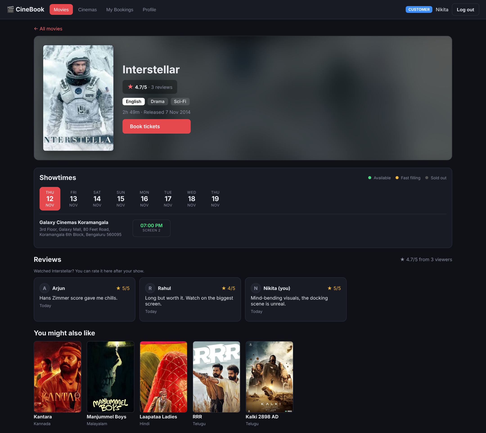 Movie page | 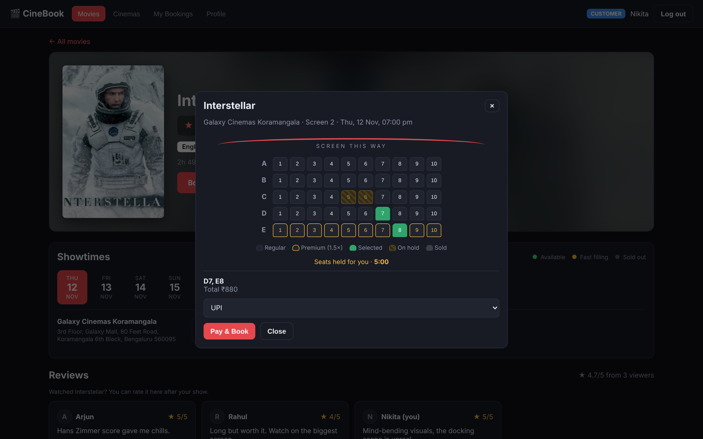 Seat map – C5/C6 on hold by another customer (Redis) |
| 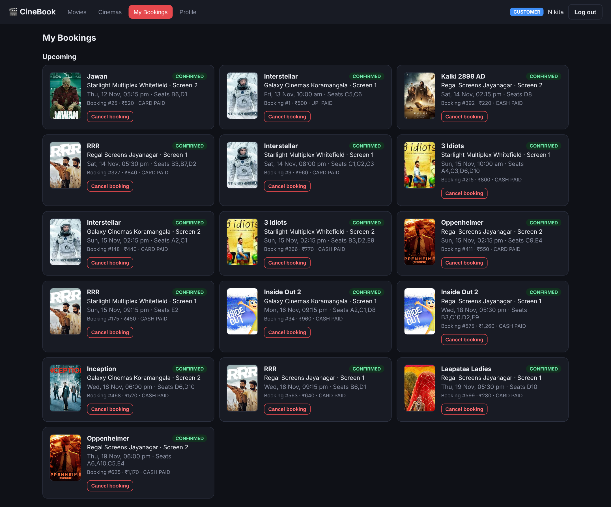 My Bookings | 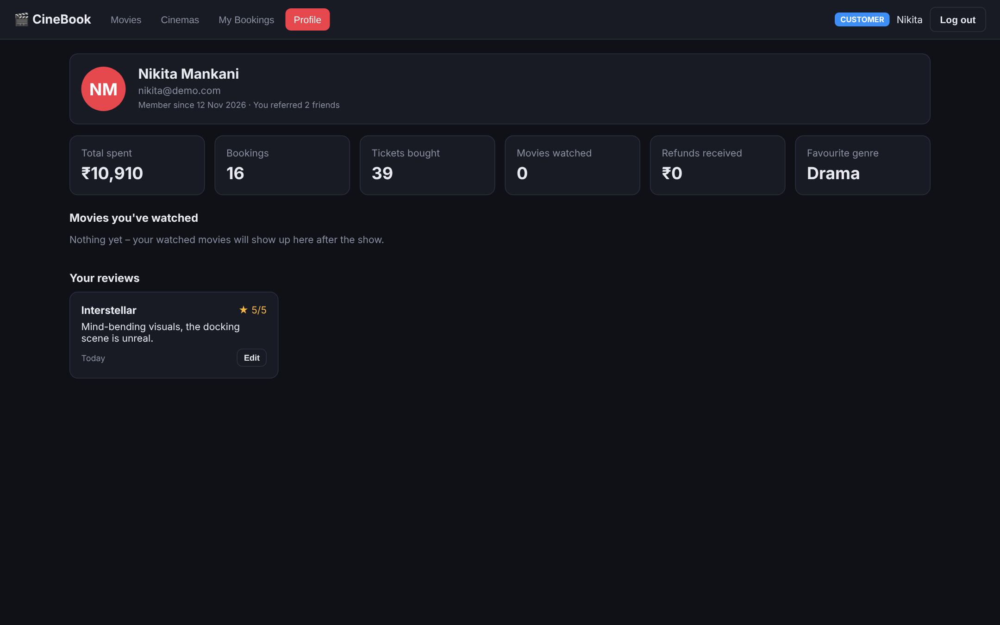 Profile |
| 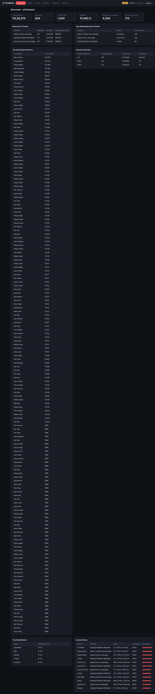 Platform admin dashboard | 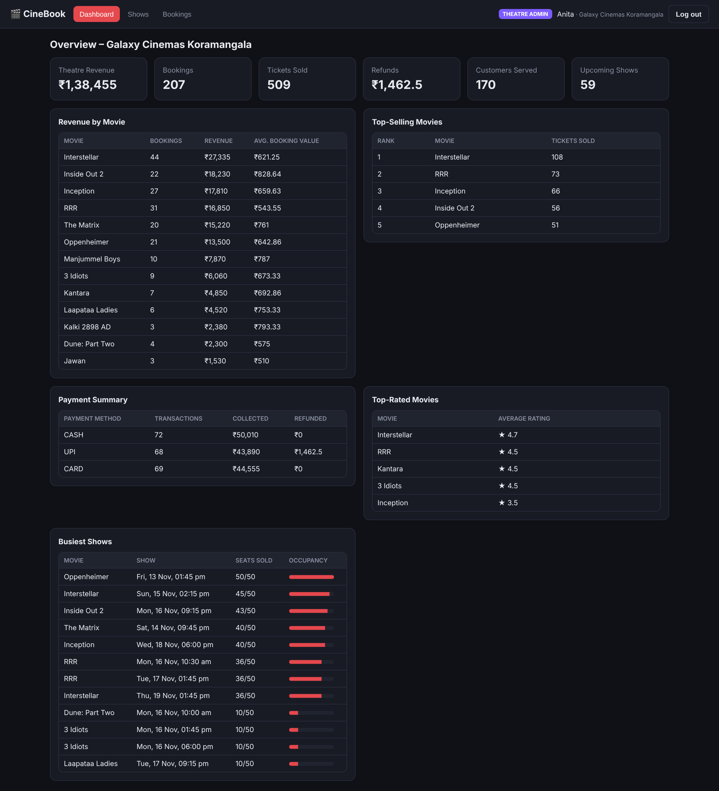 Theatre admin dashboard (own theatre only) |
| 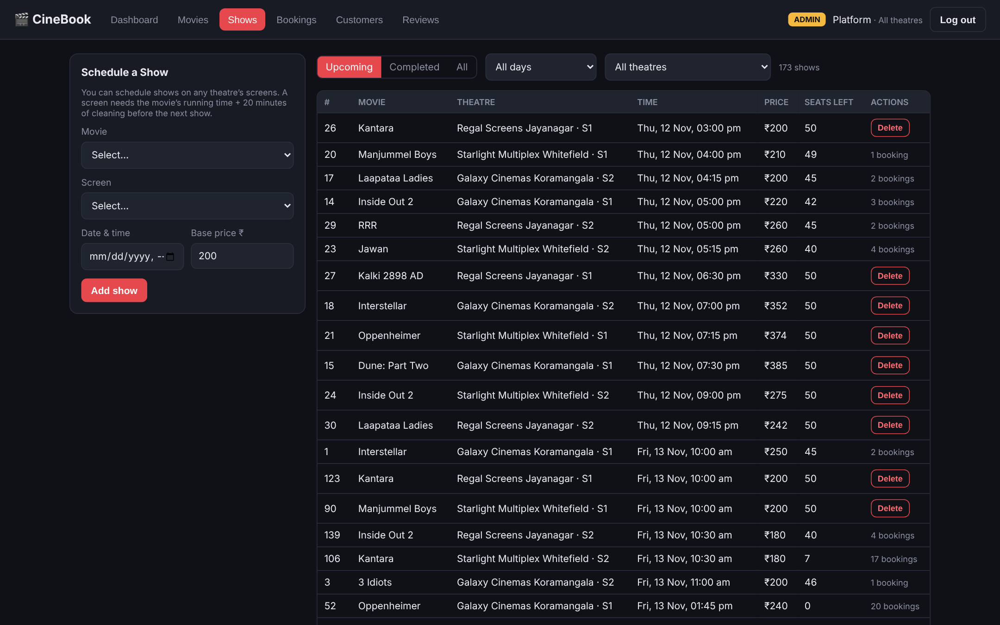 Shows | 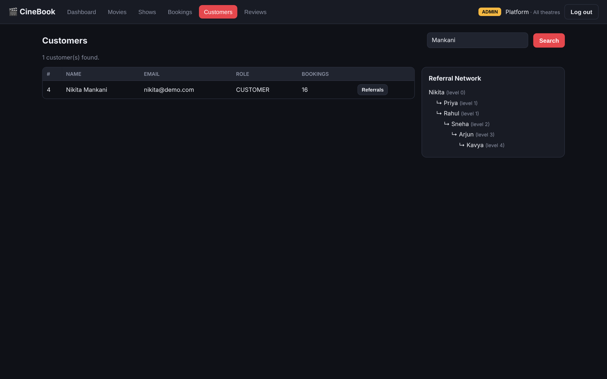 Customers + referral network |

## 11. Authentication & role-based access control

**Front end:** login/register pages; bcrypt password hashes; signed JWT in an httpOnly cookie (8 h);
`middleware.js` redirects non-admins away from `/admin` and non-customers away from `/customer`;
every API route re-checks the role (`requireRole`) → 401/403.

**Inside the database (`sql/06_roles.sql`):**

| DB role | Login | Privileges |
|---|---|---|
| `role_admin` | `cine_admin` | ALL on `movie_ticket_booking.*` |
| `role_theatre` | `cine_theatre` | SELECT on catalogue/bookings/payments; SELECT + DELETE on SHOWS; EXECUTE `sp_add_show`; only 4 USERS columns (no password hashes) |
| `role_customer` | `cine_customer` | SELECT on catalogue tables + view; SELECT on bookings/payments; **column-level** SELECT/INSERT on USERS (no Role column insert → cannot self-promote); EXECUTE on `sp_book_seats`, `sp_cancel_booking`, `fn_seats_left`, `fn_seat_price` only |

The web app holds **three connection pools** and uses the one matching the logged-in role, so the database itself
enforces RBAC. Customers change booking data only through DEFINER-rights procedures.

Two-terminal proof (`docs/sample_outputs/rbac_two_terminals.txt`):
```
cine_admin    > INSERT INTO MOVIE ...           -> 1 row inserted
cine_customer > INSERT INTO MOVIE ...           -> ERROR 1142: INSERT command denied
cine_customer > UPDATE SHOWS SET Base_Price=1   -> ERROR 1142: UPDATE command denied  (cannot change pricing)
cine_customer > UPDATE USERS SET Role='ADMIN'   -> ERROR 1142: UPDATE command denied
cine_customer > DROP TABLE PAYMENT              -> ERROR 1142: DROP command denied
cine_customer > CALL sp_book_seats(...)         -> OK (through procedure)
```

## 12. Testing

| # | Test | Expected | Result |
|---|---|---|---|
| 1 | Run 01→11 on clean MySQL 8.0.46 | no errors | ✅ |
| 2 | Book 2 seats (1 premium) | total = base + 1.5×base, payment row created | ✅ ₹500 (200 + 300) |
| 3 | Book an already-sold seat | rejected, nothing saved (rollback) | ✅ |
| 4 | Customer cancels someone else's booking | "You can cancel only your own booking" | ✅ |
| 5 | Cancel own booking | CANCELLED, REFUNDED, seats freed | ✅ |
| 6 | Admin adds overlapping show | "Screen is busy at that time" | ✅ |
| 7 | Admin adds show in another theatre | 403 | ✅ |
| 8 | Delete movie that has shows | FK error shown in UI | ✅ |
| 9 | Insert Screen_No 3 | CHECK violation | ✅ |
| 10 | Customer opens /admin or calls admin API | redirect / 403 | ✅ |
| 11 | Customer DB user INSERT/UPDATE/DROP | ERROR 1142 | ✅ |
| 12 | Register with referrer email | Referred_By set; appears in recursive tree | ✅ |
| 13 | Review create → update → delete | average in ZSET recalculated each time | ✅ |
| 14 | EXPLAIN Last_Name search | type=ref with idx_users_last_name | ✅ |
| 15 | `npm run build` | compiles, 0 errors | ✅ |
| 16 | 50 customers pay for the same seat at once | exactly 1 booking, 0 leftover rows | ✅ 1 / 49 rejected |
| 17 | 50 customers hold the same seat in Redis at once | exactly 1 hold | ✅ 1 granted |
| 18 | 500 bookings on a 10-connection pool | all commit | ✅ ~0.33 s (~1,500/s) |
| 19 | Two simultaneous cancels of one booking | refunded once | ✅ second gets "already cancelled" |
| 20 | Customer DB user changes a ticket price | ERROR 1142 | ✅ |
| 21 | Delete a show that has already started | ERROR 1644 (trigger 4) | ✅ |

## 13. Real-world viability & USP

Test: `node scripts/concurrency_test.js`
(output: `docs/sample_outputs/concurrency_test_output.txt`).

**Viability, proven by the test:**
```
T1  50 customers pay for seat C5 at the same moment  -> 1 booked, 49 rejected (ER_DUP_ENTRY), 0 leftover rows
T2  50 customers hold the same seat in Redis          -> 1 hold granted (SET NX EX 300)
T3  500 bookings, 10-connection pool                  -> 500 committed in ~0.33 s  (~1,500 bookings/s)
T4  2 simultaneous cancels of one booking             -> 1 OK, 1 "Booking already cancelled" -> refunded once
```
Why it scales: a stateless app tier (JWT), all business rules inside MySQL (so adding app servers can't introduce
bugs), short-lived seat-hold traffic kept in Redis, indexes on hot lookups, one pool per DB role. Deployment path:
N app instances behind a load balancer, a MySQL primary + read replicas for dashboards, managed Redis.

**USP vs BookMyShow:** not a better nationwide aggregator, but a booking + management system that **the theatre owns**:
self-run scheduling with automatic clash detection, theatre-owned customer and revenue analytics, verified-viewer
reviews, live seat holds, guaranteed booking correctness, security enforced inside the database, and a built-in
referral programme. A theatre can keep BookMyShow for discovery and use CineBook as its direct, owned channel.

## 14. Git, contribution & originality

- Contribution — Member 1 (Nikita Mankani): ER/relational design, DDL & constraints, triggers/functions/procedures, roles, indexing, bulk data.
  Member 2 (Niyatee Singh): Redis model & RUD, Next.js UI & API routes, authentication, testing, documentation.
- Original design: own schema (inspired by, not copied from, commercial booking apps), own seat-pricing rule,
  clash-detection procedure, referral programme, DB-level RBAC through three pools, Redis seat holds.

## 15. Conclusion

The simplified 8-entity design keeps every ER concept while remaining easy to explain. MySQL handles the transactional
core with strong constraints, triggers and procedures; Redis handles short-lived seat holds and flexible review data; the Next.js app ties both
together with authentication and role-based access enforced at both the application and the database layer.
